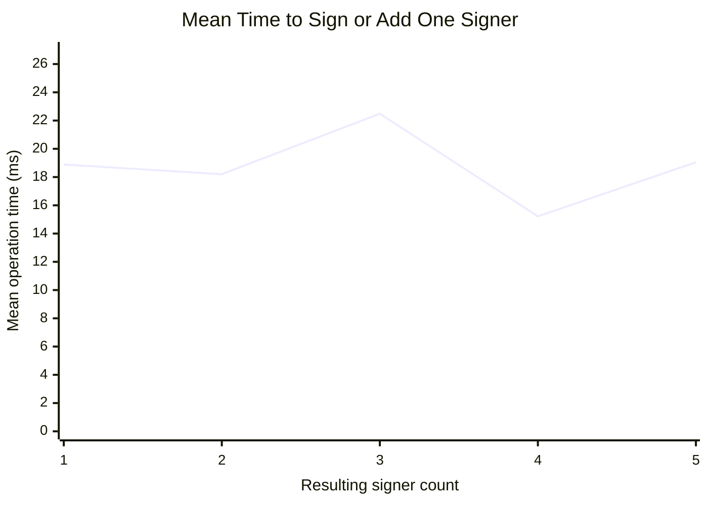

# Majik Signature Serialization Benchmark

- **Started:** 2026-10-14T04:37:51.894Z
- **Finished (benchmark operations):** 2026-10-14T04:38:16.031Z
- **Elapsed benchmark time:** 24,137.27 ms
- **Report persistence time (initial write):** 11.51 ms
- **Approximate end-to-end total:** 24,148.78 ms
- **Iterations per timing:** 5 (plus 1 warm-up iteration per operation)
- **Runtime:** Node v22.19.0 / win32 x64
- **Package:** @majikah/majik-signature@0.10.0
- **Test keys:** 5 fresh keys generated using `test/helpers/crypto.ts:getTestKey()`; key secrets are not included in this report
- **Signer-count increments:** 1 through 5

## Summary

- Fixtures benchmarked: **3**
- Fixture × signer-count size samples: **15**
- Legacy fixtures checked: **3**
- Checks passed: **246**
- Checks failed: **0**
- Average envelope JSON size across all fixture/count samples: **30,082 B (29.377 KiB)**
- Average envelope raw CBOR size across all fixture/count samples: **22,644 B (22.113 KiB)**
- Average CBOR reduction vs JSON: **24.73%**
- Average existing Base64 serialization size: **40,110 B (39.17 KiB)**
- Average embedded payload size, including prefix/wrapper: **31,154 B (30.424 KiB)**
- Average complete embedded-file growth: **31,170 B (30.439 KiB)**

## Multi-signature serialization charts

The bar chart compares measured envelope sizes at each signer count, averaged across fixtures. The line chart shows the mean time taken to sign the initial envelope or add the next signer; it is an operation time, not cumulative workflow time.

### Payload size by signer count

```mermaid
xychart-beta
    title "Average Envelope Payload Size by Signer Count"
    x-axis "Signer count" [1, 2, 3, 4, 5]
    y-axis "Payload bytes" 0 --> 77000
    bar "Minified JSON" [10046, 20064, 30082, 40100, 50118]
    bar "Raw CBOR" [7564, 15104, 22644, 30184, 37724]
    bar "Base64 serialized" [13396, 26752, 40112, 53468, 66824]
```

### Detached signing operation time by signer count

### Average sizes at each increment

| Signers | Fixtures averaged | JSON | Base64 serialized | Raw CBOR | `.mjksig` v2 | Embedded payload | Complete file growth |
|---:|---:|---:|---:|---:|---:|---:|---:|
| 1 | 3 | 10046 B | 13396 B | 7564 B | 7576 B | 10378 B | 10394 B |
| 2 | 3 | 20064 B | 26752 B | 15104 B | 15116 B | 20766 B | 20782 B |
| 3 | 3 | 30082 B | 40112 B | 22644 B | 22656 B | 31154 B | 31170 B |
| 4 | 3 | 40100 B | 53468 B | 30184 B | 30196 B | 41542 B | 41558 B |
| 5 | 3 | 50118 B | 66824 B | 37724 B | 37736 B | 51930 B | 51946 B |

### Mean detached signing time by signer count

| Resulting signers | Fixture samples | Mean time to sign/add signer |
|---:|---:|---:|
| 1 | 3 | 18.888 ms |
| 2 | 3 | 18.205 ms |
| 3 | 3 | 22.483 ms |
| 4 | 3 | 15.223 ms |
| 5 | 3 | 19.044 ms |

## Payload sizes by fixture and signer count

| Fixture | Signers | Original file | Envelope JSON | Base64 serialized | Raw CBOR | `.mjksig` v2 | Embedded payload | Full-file growth |
|---|---:|---:|---:|---:|---:|---:|---:|---:|
| sample.pdf | 1 | 95165 B | 10046 B | 13396 B | 7564 B | 7576 B | 10378 B | 10396 B |
| sample.pdf | 2 | 95165 B | 20064 B | 26752 B | 15104 B | 15116 B | 20766 B | 20784 B |
| sample.pdf | 3 | 95165 B | 30082 B | 40112 B | 22644 B | 22656 B | 31154 B | 31172 B |
| sample.pdf | 4 | 95165 B | 40100 B | 53468 B | 30184 B | 30196 B | 41542 B | 41560 B |
| sample.pdf | 5 | 95165 B | 50118 B | 66824 B | 37724 B | 37736 B | 51930 B | 51948 B |
| sample.jpg | 1 | 114051 B | 10046 B | 13396 B | 7564 B | 7576 B | 10378 B | 10388 B |
| sample.jpg | 2 | 114051 B | 20064 B | 26752 B | 15104 B | 15116 B | 20766 B | 20776 B |
| sample.jpg | 3 | 114051 B | 30082 B | 40112 B | 22644 B | 22656 B | 31154 B | 31164 B |
| sample.jpg | 4 | 114051 B | 40100 B | 53468 B | 30184 B | 30196 B | 41542 B | 41552 B |
| sample.jpg | 5 | 114051 B | 50118 B | 66824 B | 37724 B | 37736 B | 51930 B | 51940 B |
| sample.wav | 1 | 1568798 B | 10046 B | 13396 B | 7564 B | 7576 B | 10378 B | 10398 B |
| sample.wav | 2 | 1568798 B | 20064 B | 26752 B | 15104 B | 15116 B | 20766 B | 20786 B |
| sample.wav | 3 | 1568798 B | 30082 B | 40112 B | 22644 B | 22656 B | 31154 B | 31174 B |
| sample.wav | 4 | 1568798 B | 40100 B | 53468 B | 30184 B | 30196 B | 41542 B | 41562 B |
| sample.wav | 5 | 1568798 B | 50118 B | 66824 B | 37724 B | 37736 B | 51930 B | 51950 B |

### Last-signature object sizes

Signature-object sizes describe the individual signer entry added at that step; envelope columns show cumulative multi-signature growth.

| Fixture | Signers in envelope | Signature JSON | Signature Base64 serialized | Signature CBOR |
|---|---:|---:|---:|---:|
| sample.pdf | 1 | 10017 B | 13356 B | 7540 B |
| sample.pdf | 2 | 10017 B | 13356 B | 7540 B |
| sample.pdf | 3 | 10017 B | 13356 B | 7540 B |
| sample.pdf | 4 | 10017 B | 13356 B | 7540 B |
| sample.pdf | 5 | 10017 B | 13356 B | 7540 B |
| sample.jpg | 1 | 10017 B | 13356 B | 7540 B |
| sample.jpg | 2 | 10017 B | 13356 B | 7540 B |
| sample.jpg | 3 | 10017 B | 13356 B | 7540 B |
| sample.jpg | 4 | 10017 B | 13356 B | 7540 B |
| sample.jpg | 5 | 10017 B | 13356 B | 7540 B |
| sample.wav | 1 | 10017 B | 13356 B | 7540 B |
| sample.wav | 2 | 10017 B | 13356 B | 7540 B |
| sample.wav | 3 | 10017 B | 13356 B | 7540 B |
| sample.wav | 4 | 10017 B | 13356 B | 7540 B |
| sample.wav | 5 | 10017 B | 13356 B | 7540 B |

## Legacy embedded-file compatibility

| Fixture | File bytes | Legacy payload bytes | Extracted signatures | Stripped bytes | Result |
|---|---:|---:|---:|---:|---|
| compat\compat.pdf | 105485 B | 10302 | 1 | 95165 | PASS |
| compat\compat.jpg | 124363 B | 10302 | 1 | 114051 | PASS |
| compat\compat.wav | 1579120 B | 10302 | 1 | 1568798 | PASS |

## Timing results

| Operation | Iterations | Mean ms | Median ms | Min ms | Max ms | Ops/sec |
|---|---:|---:|---:|---:|---:|---:|
| sample.pdf: detached signing (signer 1/5) | 5 | 12.043 | 11.515 | 10.969 | 14.813 | 83.033 |
| sample.pdf: embedded signing (signer 1/5) | 5 | 16.292 | 16.711 | 11.063 | 21.249 | 61.378 |
| sample.pdf: detached multi-sig add signer 2/5 | 5 | 11.509 | 12.045 | 8.65 | 15.805 | 86.891 |
| sample.pdf: embedded multi-sig add signer 2/5 | 5 | 19.417 | 14.209 | 13.626 | 32.482 | 51.501 |
| sample.pdf: detached multi-sig add signer 3/5 | 5 | 14.636 | 16.54 | 8.717 | 18.791 | 68.323 |
| sample.pdf: embedded multi-sig add signer 3/5 | 5 | 14.961 | 13.165 | 11.712 | 20.068 | 66.842 |
| sample.pdf: detached multi-sig add signer 4/5 | 5 | 10.526 | 9.103 | 8.862 | 16.427 | 95.004 |
| sample.pdf: embedded multi-sig add signer 4/5 | 5 | 19.056 | 18.388 | 12.511 | 29.954 | 52.476 |
| sample.pdf: detached multi-sig add signer 5/5 | 5 | 13.488 | 14.042 | 9.712 | 18.049 | 74.139 |
| sample.pdf: embedded multi-sig add signer 5/5 | 5 | 15.451 | 16.085 | 11.266 | 21.725 | 64.722 |
| sample.pdf: extract embedded envelope (1 signers) | 5 | 0.416 | 0.41 | 0.367 | 0.503 | 2404.309 |
| sample.pdf: strip embedded envelope (1 signers) | 5 | 0.129 | 0.128 | 0.122 | 0.135 | 7747.134 |
| sample.pdf: verify detached envelope (1 signers) | 5 | 10.35 | 10.097 | 9.618 | 11.433 | 96.617 |
| sample.pdf: verify embedded file (1 signers) | 5 | 11.994 | 11.537 | 10.594 | 13.935 | 83.375 |
| sample.pdf: signature JSON encode (1-signer snapshot) | 5 | 0.016 | 0.015 | 0.015 | 0.017 | 64350.064 |
| sample.pdf: signature Base64 encode (1-signer snapshot) | 5 | 0.36 | 0.29 | 0.113 | 0.655 | 2778.858 |
| sample.pdf: signature CBOR encode (1-signer snapshot) | 5 | 0.066 | 0.038 | 0.036 | 0.177 | 15257.858 |
| sample.pdf: signature JSON decode (1-signer snapshot) | 5 | 0.01 | 0.01 | 0.009 | 0.012 | 99009.901 |
| sample.pdf: signature Base64 decode (1-signer snapshot) | 5 | 0.426 | 0.394 | 0.392 | 0.498 | 2344.776 |
| sample.pdf: signature CBOR decode (1-signer snapshot) | 5 | 0.093 | 0.092 | 0.091 | 0.095 | 10778.185 |
| sample.pdf: envelope JSON encode (1 signers) | 5 | 0.015 | 0.015 | 0.015 | 0.016 | 65274.151 |
| sample.pdf: envelope Base64 encode (1 signers) | 5 | 0.369 | 0.178 | 0.126 | 0.723 | 2712.968 |
| sample.pdf: envelope CBOR encode (1 signers) | 5 | 0.043 | 0.036 | 0.035 | 0.07 | 23288.309 |
| sample.pdf: MJKSIG v2 container encode (1 signers) | 5 | 0.046 | 0.046 | 0.042 | 0.053 | 21645.022 |
| sample.pdf: envelope JSON decode (1 signers) | 5 | 0.01 | 0.01 | 0.009 | 0.012 | 96339.114 |
| sample.pdf: envelope Base64 decode (1 signers) | 5 | 0.442 | 0.431 | 0.402 | 0.482 | 2259.989 |
| sample.pdf: envelope CBOR decode (1 signers) | 5 | 0.111 | 0.11 | 0.097 | 0.125 | 9009.009 |
| sample.pdf: MJKSIG v2 container decode (1 signers) | 5 | 0.293 | 0.16 | 0.102 | 0.81 | 3417.401 |
| sample.pdf: raw signature verification (signer 1) | 5 | 9.982 | 9.866 | 9.702 | 10.439 | 100.181 |
| sample.pdf: extract embedded envelope (2 signers) | 5 | 0.793 | 0.69 | 0.647 | 1.208 | 1261.098 |
| sample.pdf: strip embedded envelope (2 signers) | 5 | 0.197 | 0.184 | 0.109 | 0.303 | 5076.658 |
| sample.pdf: verify detached envelope (2 signers) | 5 | 19.889 | 19.801 | 19.127 | 20.602 | 50.279 |
| sample.pdf: verify embedded file (2 signers) | 5 | 20.981 | 21.199 | 20.379 | 21.468 | 47.662 |
| sample.pdf: signature JSON encode (2-signer snapshot) | 5 | 0.018 | 0.017 | 0.015 | 0.022 | 55555.556 |
| sample.pdf: signature Base64 encode (2-signer snapshot) | 5 | 0.111 | 0.109 | 0.108 | 0.116 | 9023.642 |
| sample.pdf: signature CBOR encode (2-signer snapshot) | 5 | 0.042 | 0.041 | 0.04 | 0.047 | 23764.259 |
| sample.pdf: signature JSON decode (2-signer snapshot) | 5 | 0.011 | 0.011 | 0.009 | 0.014 | 89605.735 |
| sample.pdf: signature Base64 decode (2-signer snapshot) | 5 | 0.391 | 0.383 | 0.379 | 0.417 | 2558.985 |
| sample.pdf: signature CBOR decode (2-signer snapshot) | 5 | 0.103 | 0.096 | 0.09 | 0.134 | 9699.321 |
| sample.pdf: envelope JSON encode (2 signers) | 5 | 0.03 | 0.03 | 0.029 | 0.033 | 33046.927 |
| sample.pdf: envelope Base64 encode (2 signers) | 5 | 0.23 | 0.226 | 0.217 | 0.247 | 4351.61 |
| sample.pdf: envelope CBOR encode (2 signers) | 5 | 0.305 | 0.113 | 0.066 | 1.083 | 3282.348 |
| sample.pdf: MJKSIG v2 container encode (2 signers) | 5 | 0.094 | 0.091 | 0.081 | 0.109 | 10584.251 |
| sample.pdf: envelope JSON decode (2 signers) | 5 | 0.023 | 0.023 | 0.019 | 0.026 | 44404.973 |
| sample.pdf: envelope Base64 decode (2 signers) | 5 | 0.075 | 0.075 | 0.073 | 0.076 | 13412.017 |
| sample.pdf: envelope CBOR decode (2 signers) | 5 | 0.194 | 0.165 | 0.161 | 0.298 | 5146.68 |
| sample.pdf: MJKSIG v2 container decode (2 signers) | 5 | 0.187 | 0.174 | 0.166 | 0.237 | 5354.466 |
| sample.pdf: raw signature verification (signer 2) | 5 | 9.591 | 9.69 | 9.33 | 9.738 | 104.26 |
| sample.pdf: extract embedded envelope (3 signers) | 5 | 0.956 | 0.859 | 0.847 | 1.242 | 1046.463 |
| sample.pdf: strip embedded envelope (3 signers) | 5 | 0.141 | 0.155 | 0.072 | 0.187 | 7088.177 |
| sample.pdf: verify detached envelope (3 signers) | 5 | 29.984 | 29.748 | 29.11 | 30.911 | 33.352 |
| sample.pdf: verify embedded file (3 signers) | 5 | 32.211 | 32 | 31.272 | 33.149 | 31.045 |
| sample.pdf: signature JSON encode (3-signer snapshot) | 5 | 0.017 | 0.016 | 0.016 | 0.018 | 60313.631 |
| sample.pdf: signature Base64 encode (3-signer snapshot) | 5 | 0.107 | 0.106 | 0.106 | 0.109 | 9368.559 |
| sample.pdf: signature CBOR encode (3-signer snapshot) | 5 | 0.04 | 0.04 | 0.039 | 0.042 | 24937.656 |
| sample.pdf: signature JSON decode (3-signer snapshot) | 5 | 0.01 | 0.01 | 0.009 | 0.011 | 101419.878 |
| sample.pdf: signature Base64 decode (3-signer snapshot) | 5 | 0.034 | 0.034 | 0.033 | 0.036 | 29446.408 |
| sample.pdf: signature CBOR decode (3-signer snapshot) | 5 | 0.103 | 0.097 | 0.085 | 0.132 | 9671.18 |
| sample.pdf: envelope JSON encode (3 signers) | 5 | 0.042 | 0.042 | 0.041 | 0.043 | 23912.004 |
| sample.pdf: envelope Base64 encode (3 signers) | 5 | 0.437 | 0.32 | 0.317 | 0.907 | 2290.006 |
| sample.pdf: envelope CBOR encode (3 signers) | 5 | 0.101 | 0.095 | 0.094 | 0.115 | 9942.334 |
| sample.pdf: MJKSIG v2 container encode (3 signers) | 5 | 0.101 | 0.101 | 0.094 | 0.109 | 9920.635 |
| sample.pdf: envelope JSON decode (3 signers) | 5 | 0.027 | 0.025 | 0.02 | 0.036 | 37397.158 |
| sample.pdf: envelope Base64 decode (3 signers) | 5 | 0.093 | 0.092 | 0.09 | 0.101 | 10708.931 |
| sample.pdf: envelope CBOR decode (3 signers) | 5 | 0.422 | 0.287 | 0.243 | 1.038 | 2372.367 |
| sample.pdf: MJKSIG v2 container decode (3 signers) | 5 | 0.258 | 0.257 | 0.245 | 0.275 | 3879.578 |
| sample.pdf: raw signature verification (signer 3) | 5 | 9.545 | 9.516 | 9.418 | 9.714 | 104.766 |
| sample.pdf: extract embedded envelope (4 signers) | 5 | 1.283 | 1.174 | 1.166 | 1.49 | 779.387 |
| sample.pdf: strip embedded envelope (4 signers) | 5 | 0.251 | 0.266 | 0.167 | 0.292 | 3982.16 |
| sample.pdf: verify detached envelope (4 signers) | 5 | 39.56 | 39.425 | 38.389 | 41.943 | 25.278 |
| sample.pdf: verify embedded file (4 signers) | 5 | 44.217 | 43.852 | 43.463 | 45.507 | 22.616 |
| sample.pdf: signature JSON encode (4-signer snapshot) | 5 | 0.015 | 0.015 | 0.015 | 0.017 | 65359.477 |
| sample.pdf: signature Base64 encode (4-signer snapshot) | 5 | 0.107 | 0.107 | 0.106 | 0.108 | 9338.812 |
| sample.pdf: signature CBOR encode (4-signer snapshot) | 5 | 0.045 | 0.043 | 0.037 | 0.054 | 22202.487 |
| sample.pdf: signature JSON decode (4-signer snapshot) | 5 | 0.009 | 0.009 | 0.009 | 0.011 | 105263.158 |
| sample.pdf: signature Base64 decode (4-signer snapshot) | 5 | 0.034 | 0.034 | 0.033 | 0.034 | 29832.936 |
| sample.pdf: signature CBOR decode (4-signer snapshot) | 5 | 0.096 | 0.088 | 0.082 | 0.126 | 10438.413 |
| sample.pdf: envelope JSON encode (4 signers) | 5 | 0.056 | 0.056 | 0.055 | 0.06 | 17755.682 |
| sample.pdf: envelope Base64 encode (4 signers) | 5 | 0.465 | 0.437 | 0.425 | 0.6 | 2150.63 |
| sample.pdf: envelope CBOR encode (4 signers) | 5 | 0.141 | 0.132 | 0.129 | 0.182 | 7081.15 |
| sample.pdf: MJKSIG v2 container encode (4 signers) | 5 | 0.138 | 0.137 | 0.125 | 0.148 | 7259.001 |
| sample.pdf: envelope JSON decode (4 signers) | 5 | 0.029 | 0.03 | 0.027 | 0.031 | 34129.693 |
| sample.pdf: envelope Base64 decode (4 signers) | 5 | 0.124 | 0.124 | 0.121 | 0.126 | 8091.924 |
| sample.pdf: envelope CBOR decode (4 signers) | 5 | 0.312 | 0.312 | 0.306 | 0.315 | 3207.39 |
| sample.pdf: MJKSIG v2 container decode (4 signers) | 5 | 0.32 | 0.318 | 0.314 | 0.329 | 3125 |
| sample.pdf: raw signature verification (signer 4) | 5 | 9.487 | 9.317 | 9.278 | 9.857 | 105.405 |
| sample.pdf: extract embedded envelope (5 signers) | 5 | 1.462 | 1.427 | 1.258 | 1.762 | 684.023 |
| sample.pdf: strip embedded envelope (5 signers) | 5 | 0.094 | 0.09 | 0.084 | 0.119 | 10624.734 |
| sample.pdf: verify detached envelope (5 signers) | 5 | 48.418 | 48.061 | 46.84 | 50.705 | 20.653 |
| sample.pdf: verify embedded file (5 signers) | 5 | 56.289 | 56.224 | 55.414 | 57.693 | 17.765 |
| sample.pdf: signature JSON encode (5-signer snapshot) | 5 | 0.016 | 0.016 | 0.015 | 0.018 | 63211.125 |
| sample.pdf: signature Base64 encode (5-signer snapshot) | 5 | 0.114 | 0.111 | 0.108 | 0.132 | 8747.376 |
| sample.pdf: signature CBOR encode (5-signer snapshot) | 5 | 0.038 | 0.036 | 0.034 | 0.047 | 26274.304 |
| sample.pdf: signature JSON decode (5-signer snapshot) | 5 | 0.01 | 0.009 | 0.009 | 0.011 | 103734.44 |
| sample.pdf: signature Base64 decode (5-signer snapshot) | 5 | 0.034 | 0.034 | 0.033 | 0.036 | 29274.005 |
| sample.pdf: signature CBOR decode (5-signer snapshot) | 5 | 0.097 | 0.096 | 0.084 | 0.114 | 10322.048 |
| sample.pdf: envelope JSON encode (5 signers) | 5 | 0.069 | 0.069 | 0.068 | 0.07 | 14505.367 |
| sample.pdf: envelope Base64 encode (5 signers) | 5 | 0.555 | 0.554 | 0.538 | 0.574 | 1800.893 |
| sample.pdf: envelope CBOR encode (5 signers) | 5 | 0.179 | 0.17 | 0.153 | 0.215 | 5585.968 |
| sample.pdf: MJKSIG v2 container encode (5 signers) | 5 | 0.163 | 0.162 | 0.159 | 0.172 | 6129.705 |
| sample.pdf: envelope JSON decode (5 signers) | 5 | 0.035 | 0.035 | 0.034 | 0.035 | 28719.127 |
| sample.pdf: envelope Base64 decode (5 signers) | 5 | 0.151 | 0.152 | 0.15 | 0.153 | 6601.532 |
| sample.pdf: envelope CBOR decode (5 signers) | 5 | 0.482 | 0.398 | 0.381 | 0.827 | 2075.464 |
| sample.pdf: MJKSIG v2 container decode (5 signers) | 5 | 0.416 | 0.413 | 0.407 | 0.424 | 2404.077 |
| sample.pdf: raw signature verification (signer 5) | 5 | 9.604 | 9.523 | 9.408 | 9.954 | 104.124 |
| sample.jpg: detached signing (signer 1/5) | 5 | 15.094 | 10.695 | 9.596 | 25.683 | 66.253 |
| sample.jpg: embedded signing (signer 1/5) | 5 | 12.9 | 13.633 | 9.844 | 16.321 | 77.52 |
| sample.jpg: detached multi-sig add signer 2/5 | 5 | 13.099 | 10.515 | 9.264 | 20.524 | 76.342 |
| sample.jpg: embedded multi-sig add signer 2/5 | 5 | 12.336 | 11.892 | 10.785 | 15.037 | 81.065 |
| sample.jpg: detached multi-sig add signer 3/5 | 5 | 20.295 | 16.474 | 14.396 | 28.814 | 49.272 |
| sample.jpg: embedded multi-sig add signer 3/5 | 5 | 19.165 | 17.359 | 12.153 | 26.21 | 52.179 |
| sample.jpg: detached multi-sig add signer 4/5 | 5 | 10.483 | 10.899 | 8.801 | 11.84 | 95.396 |
| sample.jpg: embedded multi-sig add signer 4/5 | 5 | 15.706 | 13.222 | 11.1 | 25.894 | 63.67 |
| sample.jpg: detached multi-sig add signer 5/5 | 5 | 15.323 | 14.039 | 12.098 | 22.207 | 65.26 |
| sample.jpg: embedded multi-sig add signer 5/5 | 5 | 13.089 | 12.777 | 11.767 | 15.323 | 76.401 |
| sample.jpg: extract embedded envelope (1 signers) | 5 | 0.413 | 0.313 | 0.295 | 0.843 | 2418.497 |
| sample.jpg: strip embedded envelope (1 signers) | 5 | 0.093 | 0.089 | 0.088 | 0.108 | 10785.16 |
| sample.jpg: verify detached envelope (1 signers) | 5 | 11.14 | 10.89 | 10.09 | 13.337 | 89.765 |
| sample.jpg: verify embedded file (1 signers) | 5 | 15.417 | 11.246 | 10.961 | 31.117 | 64.862 |
| sample.jpg: signature JSON encode (1-signer snapshot) | 5 | 0.016 | 0.016 | 0.015 | 0.018 | 62266.501 |
| sample.jpg: signature Base64 encode (1-signer snapshot) | 5 | 0.116 | 0.11 | 0.109 | 0.139 | 8588.114 |
| sample.jpg: signature CBOR encode (1-signer snapshot) | 5 | 0.038 | 0.036 | 0.034 | 0.052 | 26082.42 |
| sample.jpg: signature JSON decode (1-signer snapshot) | 5 | 0.009 | 0.009 | 0.009 | 0.011 | 105485.232 |
| sample.jpg: signature Base64 decode (1-signer snapshot) | 5 | 0.035 | 0.035 | 0.033 | 0.038 | 28425.242 |
| sample.jpg: signature CBOR decode (1-signer snapshot) | 5 | 0.085 | 0.085 | 0.083 | 0.089 | 11720.581 |
| sample.jpg: envelope JSON encode (1 signers) | 5 | 0.015 | 0.015 | 0.015 | 0.018 | 64599.483 |
| sample.jpg: envelope Base64 encode (1 signers) | 5 | 0.114 | 0.114 | 0.11 | 0.117 | 8784.259 |
| sample.jpg: envelope CBOR encode (1 signers) | 5 | 0.053 | 0.051 | 0.039 | 0.072 | 18996.96 |
| sample.jpg: MJKSIG v2 container encode (1 signers) | 5 | 0.044 | 0.042 | 0.04 | 0.053 | 22522.523 |
| sample.jpg: envelope JSON decode (1 signers) | 5 | 0.088 | 0.009 | 0.009 | 0.402 | 11423.349 |
| sample.jpg: envelope Base64 decode (1 signers) | 5 | 0.036 | 0.035 | 0.033 | 0.039 | 27870.68 |
| sample.jpg: envelope CBOR decode (1 signers) | 5 | 0.085 | 0.084 | 0.084 | 0.088 | 11753.644 |
| sample.jpg: MJKSIG v2 container decode (1 signers) | 5 | 0.092 | 0.089 | 0.086 | 0.102 | 10907.504 |
| sample.jpg: raw signature verification (signer 1) | 5 | 9.816 | 9.896 | 9.535 | 9.921 | 101.871 |
| sample.jpg: extract embedded envelope (2 signers) | 5 | 0.639 | 0.636 | 0.608 | 0.686 | 1564.553 |
| sample.jpg: strip embedded envelope (2 signers) | 5 | 0.215 | 0.235 | 0.134 | 0.261 | 4641.233 |
| sample.jpg: verify detached envelope (2 signers) | 5 | 20.015 | 19.849 | 19.454 | 20.707 | 49.964 |
| sample.jpg: verify embedded file (2 signers) | 5 | 22.683 | 21.753 | 21.043 | 26.603 | 44.087 |
| sample.jpg: signature JSON encode (2-signer snapshot) | 5 | 0.017 | 0.015 | 0.015 | 0.025 | 57339.45 |
| sample.jpg: signature Base64 encode (2-signer snapshot) | 5 | 0.11 | 0.108 | 0.107 | 0.117 | 9109.127 |
| sample.jpg: signature CBOR encode (2-signer snapshot) | 5 | 0.043 | 0.039 | 0.036 | 0.052 | 23375.409 |
| sample.jpg: signature JSON decode (2-signer snapshot) | 5 | 0.012 | 0.012 | 0.011 | 0.014 | 83333.333 |
| sample.jpg: signature Base64 decode (2-signer snapshot) | 5 | 0.056 | 0.057 | 0.052 | 0.058 | 17901.898 |
| sample.jpg: signature CBOR decode (2-signer snapshot) | 5 | 0.123 | 0.099 | 0.086 | 0.193 | 8102.415 |
| sample.jpg: envelope JSON encode (2 signers) | 5 | 0.03 | 0.029 | 0.029 | 0.033 | 33422.46 |
| sample.jpg: envelope Base64 encode (2 signers) | 5 | 0.228 | 0.218 | 0.215 | 0.267 | 4389.816 |
| sample.jpg: envelope CBOR encode (2 signers) | 5 | 0.066 | 0.066 | 0.062 | 0.069 | 15128.593 |
| sample.jpg: MJKSIG v2 container encode (2 signers) | 5 | 0.068 | 0.068 | 0.066 | 0.069 | 14810.427 |
| sample.jpg: envelope JSON decode (2 signers) | 5 | 0.016 | 0.016 | 0.015 | 0.017 | 63051.702 |
| sample.jpg: envelope Base64 decode (2 signers) | 5 | 0.106 | 0.103 | 0.097 | 0.123 | 9471.491 |
| sample.jpg: envelope CBOR decode (2 signers) | 5 | 0.172 | 0.175 | 0.163 | 0.183 | 5797.101 |
| sample.jpg: MJKSIG v2 container decode (2 signers) | 5 | 0.294 | 0.207 | 0.173 | 0.694 | 3396.047 |
| sample.jpg: raw signature verification (signer 2) | 5 | 9.931 | 9.984 | 9.784 | 10.075 | 100.698 |
| sample.jpg: extract embedded envelope (3 signers) | 5 | 1.005 | 0.921 | 0.856 | 1.411 | 995.025 |
| sample.jpg: strip embedded envelope (3 signers) | 5 | 0.112 | 0.116 | 0.097 | 0.122 | 8955.759 |
| sample.jpg: verify detached envelope (3 signers) | 5 | 30.232 | 30.561 | 29.222 | 30.877 | 33.078 |
| sample.jpg: verify embedded file (3 signers) | 5 | 38.7 | 38.077 | 33.82 | 42.047 | 25.84 |
| sample.jpg: signature JSON encode (3-signer snapshot) | 5 | 0.017 | 0.016 | 0.015 | 0.019 | 60386.473 |
| sample.jpg: signature Base64 encode (3-signer snapshot) | 5 | 0.111 | 0.11 | 0.108 | 0.117 | 9009.009 |
| sample.jpg: signature CBOR encode (3-signer snapshot) | 5 | 0.042 | 0.036 | 0.034 | 0.071 | 23584.906 |
| sample.jpg: signature JSON decode (3-signer snapshot) | 5 | 0.01 | 0.01 | 0.009 | 0.012 | 95785.441 |
| sample.jpg: signature Base64 decode (3-signer snapshot) | 5 | 0.036 | 0.034 | 0.033 | 0.04 | 27639.58 |
| sample.jpg: signature CBOR decode (3-signer snapshot) | 5 | 0.085 | 0.085 | 0.083 | 0.088 | 11778.563 |
| sample.jpg: envelope JSON encode (3 signers) | 5 | 0.127 | 0.043 | 0.042 | 0.454 | 7855.46 |
| sample.jpg: envelope Base64 encode (3 signers) | 5 | 0.457 | 0.514 | 0.33 | 0.566 | 2186.653 |
| sample.jpg: envelope CBOR encode (3 signers) | 5 | 0.154 | 0.149 | 0.146 | 0.174 | 6496.037 |
| sample.jpg: MJKSIG v2 container encode (3 signers) | 5 | 0.154 | 0.153 | 0.149 | 0.161 | 6475.845 |
| sample.jpg: envelope JSON decode (3 signers) | 5 | 0.03 | 0.03 | 0.029 | 0.032 | 33377.837 |
| sample.jpg: envelope Base64 decode (3 signers) | 5 | 0.147 | 0.144 | 0.141 | 0.158 | 6824.075 |
| sample.jpg: envelope CBOR decode (3 signers) | 5 | 0.377 | 0.377 | 0.368 | 0.385 | 2651.816 |
| sample.jpg: MJKSIG v2 container decode (3 signers) | 5 | 0.415 | 0.263 | 0.252 | 1.019 | 2411.614 |
| sample.jpg: raw signature verification (signer 3) | 5 | 10.08 | 9.777 | 9.568 | 11.198 | 99.209 |
| sample.jpg: extract embedded envelope (4 signers) | 5 | 1.182 | 1.153 | 1.125 | 1.258 | 845.981 |
| sample.jpg: strip embedded envelope (4 signers) | 5 | 0.177 | 0.178 | 0.117 | 0.248 | 5659.95 |
| sample.jpg: verify detached envelope (4 signers) | 5 | 42.763 | 41.327 | 41.073 | 45.787 | 23.384 |
| sample.jpg: verify embedded file (4 signers) | 5 | 49.265 | 46.738 | 46.638 | 54.409 | 20.298 |
| sample.jpg: signature JSON encode (4-signer snapshot) | 5 | 0.015 | 0.015 | 0.014 | 0.017 | 64683.053 |
| sample.jpg: signature Base64 encode (4-signer snapshot) | 5 | 0.108 | 0.109 | 0.107 | 0.11 | 9219.989 |
| sample.jpg: signature CBOR encode (4-signer snapshot) | 5 | 0.036 | 0.036 | 0.035 | 0.04 | 27624.309 |
| sample.jpg: signature JSON decode (4-signer snapshot) | 5 | 0.01 | 0.01 | 0.009 | 0.011 | 101214.575 |
| sample.jpg: signature Base64 decode (4-signer snapshot) | 5 | 0.035 | 0.034 | 0.033 | 0.038 | 28868.36 |
| sample.jpg: signature CBOR decode (4-signer snapshot) | 5 | 0.17 | 0.089 | 0.086 | 0.489 | 5879.586 |
| sample.jpg: envelope JSON encode (4 signers) | 5 | 0.058 | 0.056 | 0.056 | 0.064 | 17105.713 |
| sample.jpg: envelope Base64 encode (4 signers) | 5 | 0.454 | 0.454 | 0.424 | 0.474 | 2200.317 |
| sample.jpg: envelope CBOR encode (4 signers) | 5 | 0.142 | 0.13 | 0.125 | 0.186 | 7055.171 |
| sample.jpg: MJKSIG v2 container encode (4 signers) | 5 | 0.148 | 0.134 | 0.127 | 0.187 | 6762.24 |
| sample.jpg: envelope JSON decode (4 signers) | 5 | 0.028 | 0.028 | 0.027 | 0.03 | 35087.719 |
| sample.jpg: envelope Base64 decode (4 signers) | 5 | 0.125 | 0.123 | 0.121 | 0.131 | 8024.394 |
| sample.jpg: envelope CBOR decode (4 signers) | 5 | 0.414 | 0.347 | 0.31 | 0.739 | 2415.226 |
| sample.jpg: MJKSIG v2 container decode (4 signers) | 5 | 0.364 | 0.351 | 0.339 | 0.398 | 2749.821 |
| sample.jpg: raw signature verification (signer 4) | 5 | 10.087 | 9.917 | 9.541 | 11.323 | 99.141 |
| sample.jpg: extract embedded envelope (5 signers) | 5 | 1.531 | 1.412 | 1.331 | 2.036 | 653.176 |
| sample.jpg: strip embedded envelope (5 signers) | 5 | 0.185 | 0.182 | 0.17 | 0.215 | 5403.069 |
| sample.jpg: verify detached envelope (5 signers) | 5 | 50.134 | 49.945 | 48.188 | 51.74 | 19.946 |
| sample.jpg: verify embedded file (5 signers) | 5 | 61.145 | 59.383 | 57.815 | 68.349 | 16.355 |
| sample.jpg: signature JSON encode (5-signer snapshot) | 5 | 0.022 | 0.02 | 0.018 | 0.029 | 45372.051 |
| sample.jpg: signature Base64 encode (5-signer snapshot) | 5 | 0.135 | 0.133 | 0.133 | 0.141 | 7400.829 |
| sample.jpg: signature CBOR encode (5-signer snapshot) | 5 | 0.041 | 0.038 | 0.036 | 0.054 | 24509.804 |
| sample.jpg: signature JSON decode (5-signer snapshot) | 5 | 0.009 | 0.009 | 0.009 | 0.01 | 106609.808 |
| sample.jpg: signature Base64 decode (5-signer snapshot) | 5 | 0.034 | 0.034 | 0.034 | 0.035 | 29325.513 |
| sample.jpg: signature CBOR decode (5-signer snapshot) | 5 | 0.091 | 0.091 | 0.085 | 0.098 | 10955.302 |
| sample.jpg: envelope JSON encode (5 signers) | 5 | 0.139 | 0.07 | 0.07 | 0.412 | 7179.782 |
| sample.jpg: envelope Base64 encode (5 signers) | 5 | 0.588 | 0.597 | 0.56 | 0.606 | 1701.954 |
| sample.jpg: envelope CBOR encode (5 signers) | 5 | 0.197 | 0.194 | 0.163 | 0.226 | 5069.451 |
| sample.jpg: MJKSIG v2 container encode (5 signers) | 5 | 0.192 | 0.192 | 0.167 | 0.227 | 5215.94 |
| sample.jpg: envelope JSON decode (5 signers) | 5 | 0.036 | 0.036 | 0.034 | 0.038 | 27855.153 |
| sample.jpg: envelope Base64 decode (5 signers) | 5 | 0.162 | 0.154 | 0.153 | 0.189 | 6177.415 |
| sample.jpg: envelope CBOR decode (5 signers) | 5 | 1 | 0.53 | 0.404 | 2.644 | 1000.34 |
| sample.jpg: MJKSIG v2 container decode (5 signers) | 5 | 0.462 | 0.464 | 0.439 | 0.483 | 2165.533 |
| sample.jpg: raw signature verification (signer 5) | 5 | 9.945 | 9.904 | 9.716 | 10.265 | 100.555 |
| sample.wav: detached signing (signer 1/5) | 5 | 29.528 | 30.109 | 25.24 | 34.304 | 33.866 |
| sample.wav: embedded signing (signer 1/5) | 5 | 42.698 | 41.23 | 38.176 | 52.471 | 23.42 |
| sample.wav: detached multi-sig add signer 2/5 | 5 | 30.007 | 29.54 | 23.219 | 36.32 | 33.326 |
| sample.wav: embedded multi-sig add signer 2/5 | 5 | 43.06 | 41.275 | 36.98 | 54.693 | 23.223 |
| sample.wav: detached multi-sig add signer 3/5 | 5 | 32.518 | 31.845 | 25.683 | 42.48 | 30.752 |
| sample.wav: embedded multi-sig add signer 3/5 | 5 | 47.898 | 49.385 | 39.038 | 53.315 | 20.878 |
| sample.wav: detached multi-sig add signer 4/5 | 5 | 24.659 | 24.083 | 21.322 | 29.199 | 40.554 |
| sample.wav: embedded multi-sig add signer 4/5 | 5 | 44.032 | 43.184 | 40.382 | 51.42 | 22.711 |
| sample.wav: detached multi-sig add signer 5/5 | 5 | 28.32 | 26.715 | 21.102 | 38.523 | 35.311 |
| sample.wav: embedded multi-sig add signer 5/5 | 5 | 43.522 | 42.374 | 41.918 | 46.702 | 22.977 |
| sample.wav: extract embedded envelope (1 signers) | 5 | 2.993 | 2.004 | 1.536 | 6.081 | 334.149 |
| sample.wav: strip embedded envelope (1 signers) | 5 | 3.019 | 2.368 | 2.292 | 5.714 | 331.189 |
| sample.wav: verify detached envelope (1 signers) | 5 | 25.575 | 24.577 | 22.253 | 30.301 | 39.101 |
| sample.wav: verify embedded file (1 signers) | 5 | 32.19 | 32.603 | 27.447 | 37.676 | 31.065 |
| sample.wav: signature JSON encode (1-signer snapshot) | 5 | 0.019 | 0.019 | 0.018 | 0.021 | 51813.472 |
| sample.wav: signature Base64 encode (1-signer snapshot) | 5 | 0.114 | 0.109 | 0.108 | 0.134 | 8748.906 |
| sample.wav: signature CBOR encode (1-signer snapshot) | 5 | 0.033 | 0.032 | 0.032 | 0.035 | 30731.407 |
| sample.wav: signature JSON decode (1-signer snapshot) | 5 | 0.01 | 0.009 | 0.009 | 0.011 | 101010.101 |
| sample.wav: signature Base64 decode (1-signer snapshot) | 5 | 0.034 | 0.034 | 0.033 | 0.035 | 29708.853 |
| sample.wav: signature CBOR decode (1-signer snapshot) | 5 | 0.097 | 0.085 | 0.081 | 0.125 | 10334.849 |
| sample.wav: envelope JSON encode (1 signers) | 5 | 0.015 | 0.015 | 0.015 | 0.016 | 65616.798 |
| sample.wav: envelope Base64 encode (1 signers) | 5 | 0.108 | 0.108 | 0.107 | 0.109 | 9259.259 |
| sample.wav: envelope CBOR encode (1 signers) | 5 | 0.035 | 0.034 | 0.033 | 0.04 | 28604.119 |
| sample.wav: MJKSIG v2 container encode (1 signers) | 5 | 0.038 | 0.037 | 0.034 | 0.045 | 26511.135 |
| sample.wav: envelope JSON decode (1 signers) | 5 | 0.011 | 0.009 | 0.008 | 0.019 | 90909.091 |
| sample.wav: envelope Base64 decode (1 signers) | 5 | 0.044 | 0.035 | 0.033 | 0.067 | 22935.78 |
| sample.wav: envelope CBOR decode (1 signers) | 5 | 0.084 | 0.084 | 0.082 | 0.086 | 11956.002 |
| sample.wav: MJKSIG v2 container decode (1 signers) | 5 | 0.098 | 0.092 | 0.088 | 0.123 | 10212.418 |
| sample.wav: raw signature verification (signer 1) | 5 | 20.209 | 20.194 | 19.937 | 20.735 | 49.482 |
| sample.wav: extract embedded envelope (2 signers) | 5 | 4.214 | 2.382 | 1.933 | 10.278 | 237.309 |
| sample.wav: strip embedded envelope (2 signers) | 5 | 2.98 | 2.327 | 2.129 | 5.767 | 335.525 |
| sample.wav: verify detached envelope (2 signers) | 5 | 50.632 | 53.469 | 44.489 | 53.812 | 19.751 |
| sample.wav: verify embedded file (2 signers) | 5 | 61.961 | 62.067 | 60.096 | 63.075 | 16.139 |
| sample.wav: signature JSON encode (2-signer snapshot) | 5 | 0.015 | 0.015 | 0.015 | 0.017 | 65274.151 |
| sample.wav: signature Base64 encode (2-signer snapshot) | 5 | 0.107 | 0.107 | 0.107 | 0.108 | 9314.456 |
| sample.wav: signature CBOR encode (2-signer snapshot) | 5 | 0.037 | 0.033 | 0.032 | 0.049 | 27307.482 |
| sample.wav: signature JSON decode (2-signer snapshot) | 5 | 0.01 | 0.009 | 0.009 | 0.012 | 101010.101 |
| sample.wav: signature Base64 decode (2-signer snapshot) | 5 | 0.034 | 0.033 | 0.033 | 0.035 | 29779.631 |
| sample.wav: signature CBOR decode (2-signer snapshot) | 5 | 0.132 | 0.103 | 0.087 | 0.204 | 7580.352 |
| sample.wav: envelope JSON encode (2 signers) | 5 | 0.031 | 0.031 | 0.029 | 0.033 | 32258.065 |
| sample.wav: envelope Base64 encode (2 signers) | 5 | 0.226 | 0.227 | 0.22 | 0.234 | 4420.476 |
| sample.wav: envelope CBOR encode (2 signers) | 5 | 0.066 | 0.064 | 0.06 | 0.076 | 15253.203 |
| sample.wav: MJKSIG v2 container encode (2 signers) | 5 | 0.065 | 0.065 | 0.064 | 0.066 | 15465.512 |
| sample.wav: envelope JSON decode (2 signers) | 5 | 0.016 | 0.016 | 0.014 | 0.02 | 60827.251 |
| sample.wav: envelope Base64 decode (2 signers) | 5 | 0.072 | 0.065 | 0.064 | 0.085 | 13815.971 |
| sample.wav: envelope CBOR decode (2 signers) | 5 | 0.172 | 0.174 | 0.161 | 0.18 | 5816.659 |
| sample.wav: MJKSIG v2 container decode (2 signers) | 5 | 0.292 | 0.17 | 0.166 | 0.748 | 3421.143 |
| sample.wav: raw signature verification (signer 2) | 5 | 20.445 | 20.525 | 20.177 | 20.698 | 48.911 |
| sample.wav: extract embedded envelope (3 signers) | 5 | 5.439 | 3.213 | 2.064 | 13.89 | 183.864 |
| sample.wav: strip embedded envelope (3 signers) | 5 | 4.013 | 2.525 | 2.437 | 7.092 | 249.205 |
| sample.wav: verify detached envelope (3 signers) | 5 | 73.189 | 73.983 | 68.209 | 78.603 | 13.663 |
| sample.wav: verify embedded file (3 signers) | 5 | 94.347 | 93.354 | 88.164 | 101.338 | 10.599 |
| sample.wav: signature JSON encode (3-signer snapshot) | 5 | 0.019 | 0.017 | 0.017 | 0.023 | 52246.604 |
| sample.wav: signature Base64 encode (3-signer snapshot) | 5 | 0.323 | 0.29 | 0.215 | 0.434 | 3097.702 |
| sample.wav: signature CBOR encode (3-signer snapshot) | 5 | 0.037 | 0.036 | 0.035 | 0.041 | 26939.655 |
| sample.wav: signature JSON decode (3-signer snapshot) | 5 | 0.012 | 0.012 | 0.01 | 0.015 | 85324.232 |
| sample.wav: signature Base64 decode (3-signer snapshot) | 5 | 0.037 | 0.036 | 0.035 | 0.041 | 27203.482 |
| sample.wav: signature CBOR decode (3-signer snapshot) | 5 | 0.193 | 0.169 | 0.096 | 0.355 | 5174.912 |
| sample.wav: envelope JSON encode (3 signers) | 5 | 0.044 | 0.043 | 0.043 | 0.046 | 22706.63 |
| sample.wav: envelope Base64 encode (3 signers) | 5 | 0.975 | 0.367 | 0.337 | 3.409 | 1025.683 |
| sample.wav: envelope CBOR encode (3 signers) | 5 | 0.122 | 0.112 | 0.105 | 0.171 | 8185.986 |
| sample.wav: MJKSIG v2 container encode (3 signers) | 5 | 0.122 | 0.121 | 0.111 | 0.132 | 8204.792 |
| sample.wav: envelope JSON decode (3 signers) | 5 | 0.026 | 0.027 | 0.023 | 0.031 | 37993.921 |
| sample.wav: envelope Base64 decode (3 signers) | 5 | 0.102 | 0.102 | 0.099 | 0.104 | 9792.401 |
| sample.wav: envelope CBOR decode (3 signers) | 5 | 0.241 | 0.239 | 0.234 | 0.255 | 4151.789 |
| sample.wav: MJKSIG v2 container decode (3 signers) | 5 | 0.285 | 0.277 | 0.275 | 0.31 | 3502.627 |
| sample.wav: raw signature verification (signer 3) | 5 | 20.057 | 20.047 | 19.845 | 20.314 | 49.857 |
| sample.wav: extract embedded envelope (4 signers) | 5 | 4.779 | 3.153 | 2.237 | 11.413 | 209.263 |
| sample.wav: strip embedded envelope (4 signers) | 5 | 3.781 | 2.862 | 2.203 | 6.139 | 264.514 |
| sample.wav: verify detached envelope (4 signers) | 5 | 93.028 | 91.499 | 89.886 | 100.643 | 10.749 |
| sample.wav: verify embedded file (4 signers) | 5 | 116.568 | 116.475 | 115.043 | 117.531 | 8.579 |
| sample.wav: signature JSON encode (4-signer snapshot) | 5 | 0.019 | 0.019 | 0.015 | 0.025 | 52742.616 |
| sample.wav: signature Base64 encode (4-signer snapshot) | 5 | 0.107 | 0.107 | 0.106 | 0.109 | 9317.928 |
| sample.wav: signature CBOR encode (4-signer snapshot) | 5 | 0.04 | 0.035 | 0.032 | 0.062 | 25227.043 |
| sample.wav: signature JSON decode (4-signer snapshot) | 5 | 0.01 | 0.009 | 0.009 | 0.011 | 101010.101 |
| sample.wav: signature Base64 decode (4-signer snapshot) | 5 | 0.033 | 0.033 | 0.033 | 0.034 | 29940.12 |
| sample.wav: signature CBOR decode (4-signer snapshot) | 5 | 0.095 | 0.086 | 0.084 | 0.129 | 10519.672 |
| sample.wav: envelope JSON encode (4 signers) | 5 | 0.057 | 0.057 | 0.056 | 0.059 | 17458.101 |
| sample.wav: envelope Base64 encode (4 signers) | 5 | 0.442 | 0.442 | 0.425 | 0.458 | 2264.8 |
| sample.wav: envelope CBOR encode (4 signers) | 5 | 0.127 | 0.128 | 0.121 | 0.133 | 7870.297 |
| sample.wav: MJKSIG v2 container encode (4 signers) | 5 | 0.133 | 0.133 | 0.131 | 0.136 | 7526.72 |
| sample.wav: envelope JSON decode (4 signers) | 5 | 0.03 | 0.03 | 0.029 | 0.032 | 33355.57 |
| sample.wav: envelope Base64 decode (4 signers) | 5 | 0.203 | 0.132 | 0.122 | 0.492 | 4925.623 |
| sample.wav: envelope CBOR decode (4 signers) | 5 | 0.354 | 0.34 | 0.327 | 0.409 | 2824.221 |
| sample.wav: MJKSIG v2 container decode (4 signers) | 5 | 0.328 | 0.33 | 0.316 | 0.337 | 3051.572 |
| sample.wav: raw signature verification (signer 4) | 5 | 20.126 | 20.112 | 19.945 | 20.378 | 49.687 |
| sample.wav: extract embedded envelope (5 signers) | 5 | 3.099 | 2.846 | 2.619 | 3.757 | 322.647 |
| sample.wav: strip embedded envelope (5 signers) | 5 | 2.852 | 2.912 | 2.387 | 3.287 | 350.653 |
| sample.wav: verify detached envelope (5 signers) | 5 | 113.764 | 113.323 | 112.668 | 115.029 | 8.79 |
| sample.wav: verify embedded file (5 signers) | 5 | 146.682 | 146.412 | 144.769 | 148.915 | 6.817 |
| sample.wav: signature JSON encode (5-signer snapshot) | 5 | 0.015 | 0.015 | 0.014 | 0.018 | 65616.798 |
| sample.wav: signature Base64 encode (5-signer snapshot) | 5 | 0.119 | 0.109 | 0.108 | 0.147 | 8413.259 |
| sample.wav: signature CBOR encode (5-signer snapshot) | 5 | 0.038 | 0.033 | 0.031 | 0.058 | 26497.085 |
| sample.wav: signature JSON decode (5-signer snapshot) | 5 | 0.009 | 0.009 | 0.009 | 0.01 | 108695.652 |
| sample.wav: signature Base64 decode (5-signer snapshot) | 5 | 0.032 | 0.032 | 0.032 | 0.033 | 30769.231 |
| sample.wav: signature CBOR decode (5-signer snapshot) | 5 | 0.086 | 0.083 | 0.081 | 0.097 | 11690.437 |
| sample.wav: envelope JSON encode (5 signers) | 5 | 0.072 | 0.072 | 0.068 | 0.076 | 13846.58 |
| sample.wav: envelope Base64 encode (5 signers) | 5 | 0.817 | 0.588 | 0.554 | 1.777 | 1224.62 |
| sample.wav: envelope CBOR encode (5 signers) | 5 | 0.177 | 0.169 | 0.162 | 0.198 | 5657.389 |
| sample.wav: MJKSIG v2 container encode (5 signers) | 5 | 0.165 | 0.165 | 0.162 | 0.169 | 6076.072 |
| sample.wav: envelope JSON decode (5 signers) | 5 | 0.038 | 0.034 | 0.032 | 0.052 | 26511.135 |
| sample.wav: envelope Base64 decode (5 signers) | 5 | 0.15 | 0.146 | 0.145 | 0.163 | 6664.889 |
| sample.wav: envelope CBOR decode (5 signers) | 5 | 0.402 | 0.402 | 0.39 | 0.414 | 2485.213 |
| sample.wav: MJKSIG v2 container decode (5 signers) | 5 | 0.48 | 0.422 | 0.405 | 0.737 | 2081.859 |
| sample.wav: raw signature verification (signer 5) | 5 | 19.909 | 19.852 | 19.736 | 20.322 | 50.228 |
| compat\compat.pdf: legacy embedded signature extraction | 5 | 0.133 | 0.129 | 0.114 | 0.159 | 7521.059 |
| compat\compat.pdf: legacy embedded signature stripping | 5 | 0.148 | 0.138 | 0.132 | 0.172 | 6778.742 |
| compat\compat.jpg: legacy embedded signature extraction | 5 | 0.103 | 0.103 | 0.092 | 0.11 | 9721.952 |
| compat\compat.jpg: legacy embedded signature stripping | 5 | 0.2 | 0.202 | 0.176 | 0.234 | 5004.003 |
| compat\compat.wav: legacy embedded signature extraction | 5 | 2.745 | 1.921 | 1.491 | 6.258 | 364.307 |
| compat\compat.wav: legacy embedded signature stripping | 5 | 3.082 | 2.985 | 2.456 | 4.031 | 324.511 |

## Checks

| Status | Check | Details |
|---|---|---|
| PASS | sample.pdf: fixture loaded | 95165 bytes; read + Blob preparation 0.821 ms |
| PASS | sample.pdf: 1-signer envelope contains expected signer count | expected 1; received 1 |
| PASS | sample.pdf: 1-signer .mjksig v2 payload/framing matches direct CBOR | container 7576 bytes; CBOR payload 7564 bytes; framing 12 bytes |
| PASS | sample.pdf: 1-signer embedded payload uses versioned representation | 10378 UTF-8 bytes including codec prefix/wrapper |
| PASS | sample.pdf: 1-signer embedded envelope extracts all signatures | 1/1 signature(s) extracted |
| PASS | sample.pdf: 1-signer embedding/stripping preserves original bytes | stripped 95165 bytes; original 95165 bytes |
| PASS | sample.pdf: 1-signer signature JSON round trip |  |
| PASS | sample.pdf: 1-signer signature Base64 round trip |  |
| PASS | sample.pdf: 1-signer signature CBOR round trip |  |
| PASS | sample.pdf: 1-signer envelope JSON round trip |  |
| PASS | sample.pdf: 1-signer envelope Base64 round trip |  |
| PASS | sample.pdf: 1-signer envelope CBOR round trip |  |
| PASS | sample.pdf: 1-signer .mjksig round trip and v2 header | reported container version: 2 |
| PASS | sample.pdf: 1-signer detached file is canonical clean content | 95165 bytes |
| PASS | sample.pdf: all 1 detached signatures verify | 1/1 signer result(s) valid |
| PASS | sample.pdf: all 1 embedded signatures verify | 1/1 signer result(s) valid |
| PASS | sample.pdf: CBOR-restored signature verifies (signer 1) |  |
| PASS | sample.pdf: 2-signer envelope contains expected signer count | expected 2; received 2 |
| PASS | sample.pdf: 2-signer .mjksig v2 payload/framing matches direct CBOR | container 15116 bytes; CBOR payload 15104 bytes; framing 12 bytes |
| PASS | sample.pdf: 2-signer embedded payload uses versioned representation | 20766 UTF-8 bytes including codec prefix/wrapper |
| PASS | sample.pdf: 2-signer embedded envelope extracts all signatures | 2/2 signature(s) extracted |
| PASS | sample.pdf: 2-signer embedding/stripping preserves original bytes | stripped 95165 bytes; original 95165 bytes |
| PASS | sample.pdf: 2-signer signature JSON round trip |  |
| PASS | sample.pdf: 2-signer signature Base64 round trip |  |
| PASS | sample.pdf: 2-signer signature CBOR round trip |  |
| PASS | sample.pdf: 2-signer envelope JSON round trip |  |
| PASS | sample.pdf: 2-signer envelope Base64 round trip |  |
| PASS | sample.pdf: 2-signer envelope CBOR round trip |  |
| PASS | sample.pdf: 2-signer .mjksig round trip and v2 header | reported container version: 2 |
| PASS | sample.pdf: 2-signer detached file is canonical clean content | 95165 bytes |
| PASS | sample.pdf: all 2 detached signatures verify | 2/2 signer result(s) valid |
| PASS | sample.pdf: all 2 embedded signatures verify | 2/2 signer result(s) valid |
| PASS | sample.pdf: CBOR-restored signature verifies (signer 2) |  |
| PASS | sample.pdf: 3-signer envelope contains expected signer count | expected 3; received 3 |
| PASS | sample.pdf: 3-signer .mjksig v2 payload/framing matches direct CBOR | container 22656 bytes; CBOR payload 22644 bytes; framing 12 bytes |
| PASS | sample.pdf: 3-signer embedded payload uses versioned representation | 31154 UTF-8 bytes including codec prefix/wrapper |
| PASS | sample.pdf: 3-signer embedded envelope extracts all signatures | 3/3 signature(s) extracted |
| PASS | sample.pdf: 3-signer embedding/stripping preserves original bytes | stripped 95165 bytes; original 95165 bytes |
| PASS | sample.pdf: 3-signer signature JSON round trip |  |
| PASS | sample.pdf: 3-signer signature Base64 round trip |  |
| PASS | sample.pdf: 3-signer signature CBOR round trip |  |
| PASS | sample.pdf: 3-signer envelope JSON round trip |  |
| PASS | sample.pdf: 3-signer envelope Base64 round trip |  |
| PASS | sample.pdf: 3-signer envelope CBOR round trip |  |
| PASS | sample.pdf: 3-signer .mjksig round trip and v2 header | reported container version: 2 |
| PASS | sample.pdf: 3-signer detached file is canonical clean content | 95165 bytes |
| PASS | sample.pdf: all 3 detached signatures verify | 3/3 signer result(s) valid |
| PASS | sample.pdf: all 3 embedded signatures verify | 3/3 signer result(s) valid |
| PASS | sample.pdf: CBOR-restored signature verifies (signer 3) |  |
| PASS | sample.pdf: 4-signer envelope contains expected signer count | expected 4; received 4 |
| PASS | sample.pdf: 4-signer .mjksig v2 payload/framing matches direct CBOR | container 30196 bytes; CBOR payload 30184 bytes; framing 12 bytes |
| PASS | sample.pdf: 4-signer embedded payload uses versioned representation | 41542 UTF-8 bytes including codec prefix/wrapper |
| PASS | sample.pdf: 4-signer embedded envelope extracts all signatures | 4/4 signature(s) extracted |
| PASS | sample.pdf: 4-signer embedding/stripping preserves original bytes | stripped 95165 bytes; original 95165 bytes |
| PASS | sample.pdf: 4-signer signature JSON round trip |  |
| PASS | sample.pdf: 4-signer signature Base64 round trip |  |
| PASS | sample.pdf: 4-signer signature CBOR round trip |  |
| PASS | sample.pdf: 4-signer envelope JSON round trip |  |
| PASS | sample.pdf: 4-signer envelope Base64 round trip |  |
| PASS | sample.pdf: 4-signer envelope CBOR round trip |  |
| PASS | sample.pdf: 4-signer .mjksig round trip and v2 header | reported container version: 2 |
| PASS | sample.pdf: 4-signer detached file is canonical clean content | 95165 bytes |
| PASS | sample.pdf: all 4 detached signatures verify | 4/4 signer result(s) valid |
| PASS | sample.pdf: all 4 embedded signatures verify | 4/4 signer result(s) valid |
| PASS | sample.pdf: CBOR-restored signature verifies (signer 4) |  |
| PASS | sample.pdf: 5-signer envelope contains expected signer count | expected 5; received 5 |
| PASS | sample.pdf: 5-signer .mjksig v2 payload/framing matches direct CBOR | container 37736 bytes; CBOR payload 37724 bytes; framing 12 bytes |
| PASS | sample.pdf: 5-signer embedded payload uses versioned representation | 51930 UTF-8 bytes including codec prefix/wrapper |
| PASS | sample.pdf: 5-signer embedded envelope extracts all signatures | 5/5 signature(s) extracted |
| PASS | sample.pdf: 5-signer embedding/stripping preserves original bytes | stripped 95165 bytes; original 95165 bytes |
| PASS | sample.pdf: 5-signer signature JSON round trip |  |
| PASS | sample.pdf: 5-signer signature Base64 round trip |  |
| PASS | sample.pdf: 5-signer signature CBOR round trip |  |
| PASS | sample.pdf: 5-signer envelope JSON round trip |  |
| PASS | sample.pdf: 5-signer envelope Base64 round trip |  |
| PASS | sample.pdf: 5-signer envelope CBOR round trip |  |
| PASS | sample.pdf: 5-signer .mjksig round trip and v2 header | reported container version: 2 |
| PASS | sample.pdf: 5-signer detached file is canonical clean content | 95165 bytes |
| PASS | sample.pdf: all 5 detached signatures verify | 5/5 signer result(s) valid |
| PASS | sample.pdf: all 5 embedded signatures verify | 5/5 signer result(s) valid |
| PASS | sample.pdf: CBOR-restored signature verifies (signer 5) |  |
| PASS | sample.jpg: fixture loaded | 114051 bytes; read + Blob preparation 0.446 ms |
| PASS | sample.jpg: 1-signer envelope contains expected signer count | expected 1; received 1 |
| PASS | sample.jpg: 1-signer .mjksig v2 payload/framing matches direct CBOR | container 7576 bytes; CBOR payload 7564 bytes; framing 12 bytes |
| PASS | sample.jpg: 1-signer embedded payload uses versioned representation | 10378 UTF-8 bytes including codec prefix/wrapper |
| PASS | sample.jpg: 1-signer embedded envelope extracts all signatures | 1/1 signature(s) extracted |
| PASS | sample.jpg: 1-signer embedding/stripping preserves original bytes | stripped 114051 bytes; original 114051 bytes |
| PASS | sample.jpg: 1-signer signature JSON round trip |  |
| PASS | sample.jpg: 1-signer signature Base64 round trip |  |
| PASS | sample.jpg: 1-signer signature CBOR round trip |  |
| PASS | sample.jpg: 1-signer envelope JSON round trip |  |
| PASS | sample.jpg: 1-signer envelope Base64 round trip |  |
| PASS | sample.jpg: 1-signer envelope CBOR round trip |  |
| PASS | sample.jpg: 1-signer .mjksig round trip and v2 header | reported container version: 2 |
| PASS | sample.jpg: 1-signer detached file is canonical clean content | 114051 bytes |
| PASS | sample.jpg: all 1 detached signatures verify | 1/1 signer result(s) valid |
| PASS | sample.jpg: all 1 embedded signatures verify | 1/1 signer result(s) valid |
| PASS | sample.jpg: CBOR-restored signature verifies (signer 1) |  |
| PASS | sample.jpg: 2-signer envelope contains expected signer count | expected 2; received 2 |
| PASS | sample.jpg: 2-signer .mjksig v2 payload/framing matches direct CBOR | container 15116 bytes; CBOR payload 15104 bytes; framing 12 bytes |
| PASS | sample.jpg: 2-signer embedded payload uses versioned representation | 20766 UTF-8 bytes including codec prefix/wrapper |
| PASS | sample.jpg: 2-signer embedded envelope extracts all signatures | 2/2 signature(s) extracted |
| PASS | sample.jpg: 2-signer embedding/stripping preserves original bytes | stripped 114051 bytes; original 114051 bytes |
| PASS | sample.jpg: 2-signer signature JSON round trip |  |
| PASS | sample.jpg: 2-signer signature Base64 round trip |  |
| PASS | sample.jpg: 2-signer signature CBOR round trip |  |
| PASS | sample.jpg: 2-signer envelope JSON round trip |  |
| PASS | sample.jpg: 2-signer envelope Base64 round trip |  |
| PASS | sample.jpg: 2-signer envelope CBOR round trip |  |
| PASS | sample.jpg: 2-signer .mjksig round trip and v2 header | reported container version: 2 |
| PASS | sample.jpg: 2-signer detached file is canonical clean content | 114051 bytes |
| PASS | sample.jpg: all 2 detached signatures verify | 2/2 signer result(s) valid |
| PASS | sample.jpg: all 2 embedded signatures verify | 2/2 signer result(s) valid |
| PASS | sample.jpg: CBOR-restored signature verifies (signer 2) |  |
| PASS | sample.jpg: 3-signer envelope contains expected signer count | expected 3; received 3 |
| PASS | sample.jpg: 3-signer .mjksig v2 payload/framing matches direct CBOR | container 22656 bytes; CBOR payload 22644 bytes; framing 12 bytes |
| PASS | sample.jpg: 3-signer embedded payload uses versioned representation | 31154 UTF-8 bytes including codec prefix/wrapper |
| PASS | sample.jpg: 3-signer embedded envelope extracts all signatures | 3/3 signature(s) extracted |
| PASS | sample.jpg: 3-signer embedding/stripping preserves original bytes | stripped 114051 bytes; original 114051 bytes |
| PASS | sample.jpg: 3-signer signature JSON round trip |  |
| PASS | sample.jpg: 3-signer signature Base64 round trip |  |
| PASS | sample.jpg: 3-signer signature CBOR round trip |  |
| PASS | sample.jpg: 3-signer envelope JSON round trip |  |
| PASS | sample.jpg: 3-signer envelope Base64 round trip |  |
| PASS | sample.jpg: 3-signer envelope CBOR round trip |  |
| PASS | sample.jpg: 3-signer .mjksig round trip and v2 header | reported container version: 2 |
| PASS | sample.jpg: 3-signer detached file is canonical clean content | 114051 bytes |
| PASS | sample.jpg: all 3 detached signatures verify | 3/3 signer result(s) valid |
| PASS | sample.jpg: all 3 embedded signatures verify | 3/3 signer result(s) valid |
| PASS | sample.jpg: CBOR-restored signature verifies (signer 3) |  |
| PASS | sample.jpg: 4-signer envelope contains expected signer count | expected 4; received 4 |
| PASS | sample.jpg: 4-signer .mjksig v2 payload/framing matches direct CBOR | container 30196 bytes; CBOR payload 30184 bytes; framing 12 bytes |
| PASS | sample.jpg: 4-signer embedded payload uses versioned representation | 41542 UTF-8 bytes including codec prefix/wrapper |
| PASS | sample.jpg: 4-signer embedded envelope extracts all signatures | 4/4 signature(s) extracted |
| PASS | sample.jpg: 4-signer embedding/stripping preserves original bytes | stripped 114051 bytes; original 114051 bytes |
| PASS | sample.jpg: 4-signer signature JSON round trip |  |
| PASS | sample.jpg: 4-signer signature Base64 round trip |  |
| PASS | sample.jpg: 4-signer signature CBOR round trip |  |
| PASS | sample.jpg: 4-signer envelope JSON round trip |  |
| PASS | sample.jpg: 4-signer envelope Base64 round trip |  |
| PASS | sample.jpg: 4-signer envelope CBOR round trip |  |
| PASS | sample.jpg: 4-signer .mjksig round trip and v2 header | reported container version: 2 |
| PASS | sample.jpg: 4-signer detached file is canonical clean content | 114051 bytes |
| PASS | sample.jpg: all 4 detached signatures verify | 4/4 signer result(s) valid |
| PASS | sample.jpg: all 4 embedded signatures verify | 4/4 signer result(s) valid |
| PASS | sample.jpg: CBOR-restored signature verifies (signer 4) |  |
| PASS | sample.jpg: 5-signer envelope contains expected signer count | expected 5; received 5 |
| PASS | sample.jpg: 5-signer .mjksig v2 payload/framing matches direct CBOR | container 37736 bytes; CBOR payload 37724 bytes; framing 12 bytes |
| PASS | sample.jpg: 5-signer embedded payload uses versioned representation | 51930 UTF-8 bytes including codec prefix/wrapper |
| PASS | sample.jpg: 5-signer embedded envelope extracts all signatures | 5/5 signature(s) extracted |
| PASS | sample.jpg: 5-signer embedding/stripping preserves original bytes | stripped 114051 bytes; original 114051 bytes |
| PASS | sample.jpg: 5-signer signature JSON round trip |  |
| PASS | sample.jpg: 5-signer signature Base64 round trip |  |
| PASS | sample.jpg: 5-signer signature CBOR round trip |  |
| PASS | sample.jpg: 5-signer envelope JSON round trip |  |
| PASS | sample.jpg: 5-signer envelope Base64 round trip |  |
| PASS | sample.jpg: 5-signer envelope CBOR round trip |  |
| PASS | sample.jpg: 5-signer .mjksig round trip and v2 header | reported container version: 2 |
| PASS | sample.jpg: 5-signer detached file is canonical clean content | 114051 bytes |
| PASS | sample.jpg: all 5 detached signatures verify | 5/5 signer result(s) valid |
| PASS | sample.jpg: all 5 embedded signatures verify | 5/5 signer result(s) valid |
| PASS | sample.jpg: CBOR-restored signature verifies (signer 5) |  |
| PASS | sample.wav: fixture loaded | 1568798 bytes; read + Blob preparation 3.521 ms |
| PASS | sample.wav: 1-signer envelope contains expected signer count | expected 1; received 1 |
| PASS | sample.wav: 1-signer .mjksig v2 payload/framing matches direct CBOR | container 7576 bytes; CBOR payload 7564 bytes; framing 12 bytes |
| PASS | sample.wav: 1-signer embedded payload uses versioned representation | 10378 UTF-8 bytes including codec prefix/wrapper |
| PASS | sample.wav: 1-signer embedded envelope extracts all signatures | 1/1 signature(s) extracted |
| PASS | sample.wav: 1-signer embedding/stripping preserves original bytes | stripped 1568798 bytes; original 1568798 bytes |
| PASS | sample.wav: 1-signer signature JSON round trip |  |
| PASS | sample.wav: 1-signer signature Base64 round trip |  |
| PASS | sample.wav: 1-signer signature CBOR round trip |  |
| PASS | sample.wav: 1-signer envelope JSON round trip |  |
| PASS | sample.wav: 1-signer envelope Base64 round trip |  |
| PASS | sample.wav: 1-signer envelope CBOR round trip |  |
| PASS | sample.wav: 1-signer .mjksig round trip and v2 header | reported container version: 2 |
| PASS | sample.wav: 1-signer detached file is canonical clean content | 1568798 bytes |
| PASS | sample.wav: all 1 detached signatures verify | 1/1 signer result(s) valid |
| PASS | sample.wav: all 1 embedded signatures verify | 1/1 signer result(s) valid |
| PASS | sample.wav: CBOR-restored signature verifies (signer 1) |  |
| PASS | sample.wav: 2-signer envelope contains expected signer count | expected 2; received 2 |
| PASS | sample.wav: 2-signer .mjksig v2 payload/framing matches direct CBOR | container 15116 bytes; CBOR payload 15104 bytes; framing 12 bytes |
| PASS | sample.wav: 2-signer embedded payload uses versioned representation | 20766 UTF-8 bytes including codec prefix/wrapper |
| PASS | sample.wav: 2-signer embedded envelope extracts all signatures | 2/2 signature(s) extracted |
| PASS | sample.wav: 2-signer embedding/stripping preserves original bytes | stripped 1568798 bytes; original 1568798 bytes |
| PASS | sample.wav: 2-signer signature JSON round trip |  |
| PASS | sample.wav: 2-signer signature Base64 round trip |  |
| PASS | sample.wav: 2-signer signature CBOR round trip |  |
| PASS | sample.wav: 2-signer envelope JSON round trip |  |
| PASS | sample.wav: 2-signer envelope Base64 round trip |  |
| PASS | sample.wav: 2-signer envelope CBOR round trip |  |
| PASS | sample.wav: 2-signer .mjksig round trip and v2 header | reported container version: 2 |
| PASS | sample.wav: 2-signer detached file is canonical clean content | 1568798 bytes |
| PASS | sample.wav: all 2 detached signatures verify | 2/2 signer result(s) valid |
| PASS | sample.wav: all 2 embedded signatures verify | 2/2 signer result(s) valid |
| PASS | sample.wav: CBOR-restored signature verifies (signer 2) |  |
| PASS | sample.wav: 3-signer envelope contains expected signer count | expected 3; received 3 |
| PASS | sample.wav: 3-signer .mjksig v2 payload/framing matches direct CBOR | container 22656 bytes; CBOR payload 22644 bytes; framing 12 bytes |
| PASS | sample.wav: 3-signer embedded payload uses versioned representation | 31154 UTF-8 bytes including codec prefix/wrapper |
| PASS | sample.wav: 3-signer embedded envelope extracts all signatures | 3/3 signature(s) extracted |
| PASS | sample.wav: 3-signer embedding/stripping preserves original bytes | stripped 1568798 bytes; original 1568798 bytes |
| PASS | sample.wav: 3-signer signature JSON round trip |  |
| PASS | sample.wav: 3-signer signature Base64 round trip |  |
| PASS | sample.wav: 3-signer signature CBOR round trip |  |
| PASS | sample.wav: 3-signer envelope JSON round trip |  |
| PASS | sample.wav: 3-signer envelope Base64 round trip |  |
| PASS | sample.wav: 3-signer envelope CBOR round trip |  |
| PASS | sample.wav: 3-signer .mjksig round trip and v2 header | reported container version: 2 |
| PASS | sample.wav: 3-signer detached file is canonical clean content | 1568798 bytes |
| PASS | sample.wav: all 3 detached signatures verify | 3/3 signer result(s) valid |
| PASS | sample.wav: all 3 embedded signatures verify | 3/3 signer result(s) valid |
| PASS | sample.wav: CBOR-restored signature verifies (signer 3) |  |
| PASS | sample.wav: 4-signer envelope contains expected signer count | expected 4; received 4 |
| PASS | sample.wav: 4-signer .mjksig v2 payload/framing matches direct CBOR | container 30196 bytes; CBOR payload 30184 bytes; framing 12 bytes |
| PASS | sample.wav: 4-signer embedded payload uses versioned representation | 41542 UTF-8 bytes including codec prefix/wrapper |
| PASS | sample.wav: 4-signer embedded envelope extracts all signatures | 4/4 signature(s) extracted |
| PASS | sample.wav: 4-signer embedding/stripping preserves original bytes | stripped 1568798 bytes; original 1568798 bytes |
| PASS | sample.wav: 4-signer signature JSON round trip |  |
| PASS | sample.wav: 4-signer signature Base64 round trip |  |
| PASS | sample.wav: 4-signer signature CBOR round trip |  |
| PASS | sample.wav: 4-signer envelope JSON round trip |  |
| PASS | sample.wav: 4-signer envelope Base64 round trip |  |
| PASS | sample.wav: 4-signer envelope CBOR round trip |  |
| PASS | sample.wav: 4-signer .mjksig round trip and v2 header | reported container version: 2 |
| PASS | sample.wav: 4-signer detached file is canonical clean content | 1568798 bytes |
| PASS | sample.wav: all 4 detached signatures verify | 4/4 signer result(s) valid |
| PASS | sample.wav: all 4 embedded signatures verify | 4/4 signer result(s) valid |
| PASS | sample.wav: CBOR-restored signature verifies (signer 4) |  |
| PASS | sample.wav: 5-signer envelope contains expected signer count | expected 5; received 5 |
| PASS | sample.wav: 5-signer .mjksig v2 payload/framing matches direct CBOR | container 37736 bytes; CBOR payload 37724 bytes; framing 12 bytes |
| PASS | sample.wav: 5-signer embedded payload uses versioned representation | 51930 UTF-8 bytes including codec prefix/wrapper |
| PASS | sample.wav: 5-signer embedded envelope extracts all signatures | 5/5 signature(s) extracted |
| PASS | sample.wav: 5-signer embedding/stripping preserves original bytes | stripped 1568798 bytes; original 1568798 bytes |
| PASS | sample.wav: 5-signer signature JSON round trip |  |
| PASS | sample.wav: 5-signer signature Base64 round trip |  |
| PASS | sample.wav: 5-signer signature CBOR round trip |  |
| PASS | sample.wav: 5-signer envelope JSON round trip |  |
| PASS | sample.wav: 5-signer envelope Base64 round trip |  |
| PASS | sample.wav: 5-signer envelope CBOR round trip |  |
| PASS | sample.wav: 5-signer .mjksig round trip and v2 header | reported container version: 2 |
| PASS | sample.wav: 5-signer detached file is canonical clean content | 1568798 bytes |
| PASS | sample.wav: all 5 detached signatures verify | 5/5 signer result(s) valid |
| PASS | sample.wav: all 5 embedded signatures verify | 5/5 signer result(s) valid |
| PASS | sample.wav: CBOR-restored signature verifies (signer 5) |  |
| PASS | compat\compat.pdf: legacy JSON embedded envelope remains readable | 1 signature(s); payload 10302 bytes; stripped file 95165/105485 bytes |
| PASS | compat\compat.jpg: legacy JSON embedded envelope remains readable | 1 signature(s); payload 10302 bytes; stripped file 114051/124363 bytes |
| PASS | compat\compat.wav: legacy JSON embedded envelope remains readable | 1 signature(s); payload 10302 bytes; stripped file 1568798/1579120 bytes |

## Analysis

- Across 15 measured fixture-by-signer-count sample(s) spanning 3 actual fixture(s), the average envelope representation is 30082 bytes as minified JSON, 22644 bytes as raw CBOR, and 40110 bytes using the existing Base64 serializer. Across these samples, raw CBOR is 24.73% smaller than minified JSON on average.
- From 1 signer to 5 signer(s), average minified JSON size changes by +40072 bytes (+398.89%); raw CBOR changes by +30160 bytes (+398.73%); existing Base64 serialization changes by +53428 bytes (+398.84%). The trend is measured from actual SDK envelopes at every signer count, not linearly extrapolated.
- The embedded payload, including its version marker and Base64 wrapper, averages 31154 bytes across all measured samples. Compared with the existing Base64 envelope serialization, it is 22.33% smaller on average; this is a representation comparison, not a claim that the embedded payload is raw CBOR.
- The complete embedded file grows by an average of 31170 bytes. This includes the handler's metadata/trailer overhead and can differ from the payload size.
- Raw CBOR is the best fit when a consumer accepts binary data directly. The versioned .mjksig container adds a small header for identification and version dispatch; embedded payloads add their text prefix and Base64 overhead because the existing format handlers accept string payloads.
- JSON remains useful for inspection and JSON-native integrations. The existing Base64 serializer is appropriate for text-only transport. Use .mjksig when a detached envelope needs to be self-identifying and versioned.

## Interpretation notes

- All byte counts are measured from the current SDK checkout; they are not estimates copied from the README.
- Each signer-count increment uses one additional freshly generated `MajikKey`; keys are created with the existing `getTestKey()` helper.
- `JSON` measures UTF-8 bytes of minified `JSON.stringify(envelope.toJSON())`.
- `Base64 serialized` measures the actual string returned by `envelope.serialize()`.
- `Raw CBOR` measures `envelope.toCBOR()` bytes with no `.mjksig` container header.
- `.mjksig v2` measures `envelope.toMJKSIGBytes()`, including its actual header/framing.
- `Embedded payload` measures the exact UTF-8 string extracted by the selected file handler, including the version prefix and Base64 wrapper.
- `Full-file growth` is the final embedded Blob length minus the original fixture length; it includes native metadata/trailer overhead and can differ from the embedded-payload length.
- Timing for signer count N measures the first detached signature (N=1) or the operation that adds signer N to an envelope with N-1 existing signers. The chart reports means averaged across fixtures.
- Timings include one warm-up call per operation before measured iterations. Aggregate key generation/setup time is reported separately.
- Benchmark times are environment-dependent. Use the same runtime, machine, iteration count, signer count, and fixture set when comparing commits.
